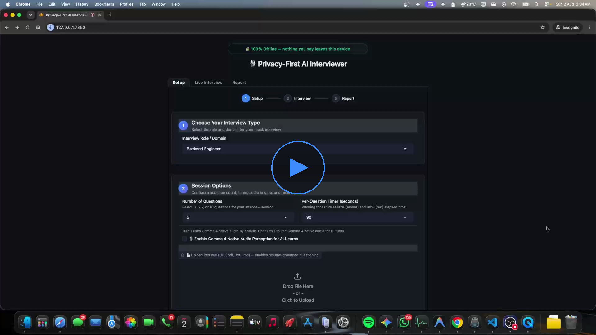
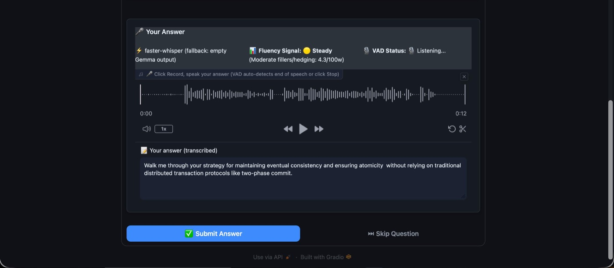
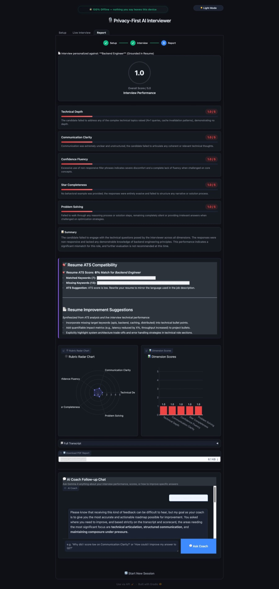

# Privacy-First AI Interviewer 🎙️🔒

> A spoken mock-interview platform that runs entirely on your own machine, powered by **Gemma 4** via Ollama.
> Your voice, resume, and answers never leave your device.

🏆 **Winner — ML Nashik Hackathon (30 July 2026)**

[](https://www.python.org/)
[](LICENSE)
[](https://ollama.com/library/gemma4)
[](#-privacy)
[](#-running-tests)
[](CONTRIBUTING.md)

<!-- Demo video is hosted as a release asset to keep the repo small -->
[](https://github.com/SiddheshSuryawanshi17/privacy-first-ai-interviewer/releases/download/v1.0.0/mlinterview.mp4)

<sub>▶️ Click the image to watch the demo video.</sub>

### Screenshots

| Live interview | Report & AI coach |
|---|---|
|  |  |

---

## Why this exists

Mock interviews with cloud AI tools mean uploading your resume and recording your voice to someone else's server. This project does the whole loop — speech-to-text, question generation, evaluation, and the final report — locally, so students, placement cells, and privacy-sensitive teams can practise without leaking data or paying for API calls.

## ✨ Features

| | |
|---|---|
| 🎤 **Spoken interviews** | Answer out loud; local Whisper transcribes, Piper reads questions aloud |
| 📄 **Resume & JD aware** | Upload a PDF resume and/or paste a job description — questions are anchored in *your* projects and the JD's requirements |
| 🧭 **Role auto-detection** | Detects the best-fit role from your resume/JD and suggests a switch if you picked a mismatched one |
| 📈 **Adaptive difficulty** | Gemma assesses each answer and escalates or eases off one step at a time |
| 📊 **Offline ATS score** | Keyword match %, missing skills, and suggestions — computed locally |
| 📝 **Detailed report** | 5-dimension scorecard, per-question feedback, model answers, radar/bar charts, and a downloadable PDF |
| 💬 **AI coach chat** | Ask follow-up questions about your performance after the session |
| ⏱️ **Session controls** | 3 / 5 / 7 / 10 questions, 60 / 90 / 120 s per-question timer with warning tones |
| 🌗 **Light & dark themes** | One-click toggle, remembered in the browser |

### Interview roles

`Backend Engineer` · `Frontend Engineer` · `DevOps / SRE` · `Cloud Computing` · `System Design` · `HR Round`

**Wanted:** AI/ML, Cybersecurity, Data Engineering, Mobile… → see [Adding a new interview role](docs/adding_a_role.md). It's a great first contribution.

## 🛠️ Tech stack

| Layer | Technology |
|---|---|
| LLM | **Gemma 4** (`gemma4:4b` by default) served by **Ollama** |
| UI | Gradio 4 + custom CSS (`theme.css`) |
| Speech-to-text | Gemma 4 native audio, with `faster-whisper` fallback |
| Voice activity detection | Silero VAD (optional) |
| Text-to-speech | Piper TTS |
| Resume parsing | `pypdf` → `PyPDF2` → `pdfplumber` fallback chain |
| ATS scoring | `ats-resume-checker` + built-in keyword fallback |
| Storage | SQLite (`data/interview_sessions.db`) |
| Reports | ReportLab (PDF) + Plotly (charts) |

## 🚀 Quick start

**Prerequisites:** Python 3.9+, [Ollama](https://ollama.com), 8 GB+ RAM recommended, a microphone.

```bash
# 1. Get a Gemma 4 model and start Ollama (keep this terminal open)
ollama pull gemma4:4b
ollama serve

# 2. Clone and set up
git clone https://github.com/SiddheshSuryawanshi17/privacy-first-ai-interviewer.git
cd privacy-first-ai-interviewer
python3 -m venv .venv
source .venv/bin/activate          # Windows: .venv\Scripts\activate
pip install -r requirements.txt

# 3. Run
python app.py
```

Open **http://127.0.0.1:7860**.

> **First run:** the Whisper speech model and Piper voice (~60 MB) are downloaded once into the local cache / `data/`. After that the app works with no internet connection.

### Configuration

All settings are optional environment variables — copy [`.env.example`](.env.example) to see them:

| Variable | Default | Purpose |
|---|---|---|
| `OLLAMA_BASE_URL` | `http://localhost:11434` | Where Ollama is running |
| `OLLAMA_MODEL` | `gemma4:4b` | Preferred model (falls back to any installed Gemma model) |
| `OLLAMA_TIMEOUT` | `300` | LLM request timeout in seconds |
| `PIPER_VOICE` | `en_US-lessac-medium` | Piper voice name |
| `PIPER_BIN` | `piper` | Path to the Piper binary |

> **macOS + Piper:** if the `piper-tts` wheel misbehaves, download the binary from [rhasspy/piper releases](https://github.com/rhasspy/piper/releases) and point `PIPER_BIN` at it.

### Optional extras

```bash
pip install silero-vad        # automatic end-of-speech detection
pip install streamlit         # session analytics dashboard:
streamlit run report_viewer/streamlit_app.py
```

## 🧪 Running tests

The suite mocks Ollama and audio, so it needs no network or GPU:

```bash
python -m pytest tests/ -v
```

The two end-to-end session tests take ~80 s each; skip them while iterating with `python -m pytest tests/ -k "not e2e"`.

## 📁 Project structure

```
.
├── app.py                  # Gradio app: Setup → Interview → Report
├── theme.css               # Design system (light & dark)
├── llm/
│   ├── client.py           # Ollama/Gemma wrapper: questions, scoring, feedback, coach chat
│   ├── prompts.py          # System prompts & per-role focus areas
│   └── parser.py           # Defensive JSON parsing with fallback scorecard
├── stt/
│   ├── gemma_audio.py      # Gemma 4 native audio transcription
│   ├── transcribe.py       # faster-whisper fallback
│   ├── vad.py              # Silero voice activity detection
│   └── confidence.py       # Filler-word / hedging fluency signal
├── tts/speak.py            # Piper TTS (auto-downloads the voice)
├── utils/
│   ├── resume.py           # Resume/JD extraction & role detection
│   └── ats.py              # Offline ATS scoring & role keyword lists
├── memory/                 # SQLite schema + persistence
├── report/                 # PDF report generator
├── report_viewer/          # Optional Streamlit analytics dashboard
├── tests/                  # 125 pytest tests
├── data/                   # Runtime data (git-ignored): DB, reports, voices
└── docs/                   # Contributor guides, demo script, dev log
```

## 🔒 Privacy

- All inference runs on your machine through Ollama — no cloud APIs, no telemetry.
- Audio is transcribed locally and not kept after transcription.
- Sessions, transcripts, and PDF reports are written only to `data/`, which is git-ignored so personal data can't be committed by accident.
- The only network access is the one-time model download on first run.

## 🤝 Contributing

Contributions of all sizes are welcome — new interview roles, UI polish, better prompts, more languages, bug fixes, docs. Start with [CONTRIBUTING.md](CONTRIBUTING.md), and please follow our [Code of Conduct](CODE_OF_CONDUCT.md).

Ideas on the roadmap:

- [ ] More interview roles: AI/ML, Cybersecurity, Data Engineering, Mobile
- [ ] Multilingual interviews (Hindi, Marathi, …)
- [ ] Docker image for one-command setup
- [ ] GitHub Actions CI
- [ ] Coding-round mode with an in-browser editor

## 👥 Team

Built at the ML Nashik Hackathon by:

- **Siddhesh Suryawanshi** — [@SiddheshSuryawanshi17](https://github.com/SiddheshSuryawanshi17)
- **Ayush Patel** — [@Ayushpate2003](https://github.com/Ayushpate2003)
- **Rutuja Kulkarni** — [@RutujaKulkarni-23](https://github.com/RutujaKulkarni-23)
- **Tanishka Prasad Jadhav**

The original team repository, where the hackathon work happened, is [Ayushpate2003/ml-interviewer](https://github.com/Ayushpate2003/ml-interviewer).

## 📄 License

[Apache License 2.0](LICENSE)
